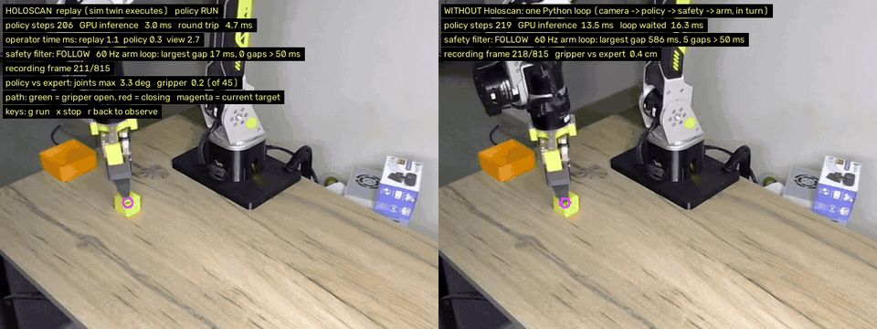
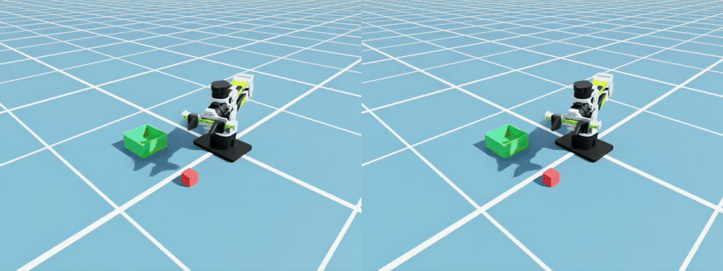
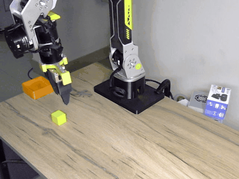
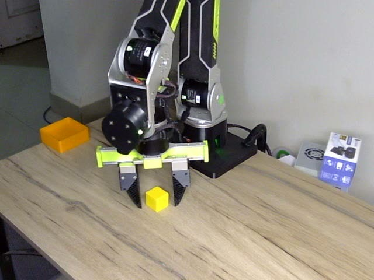
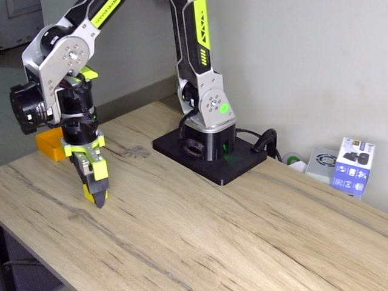
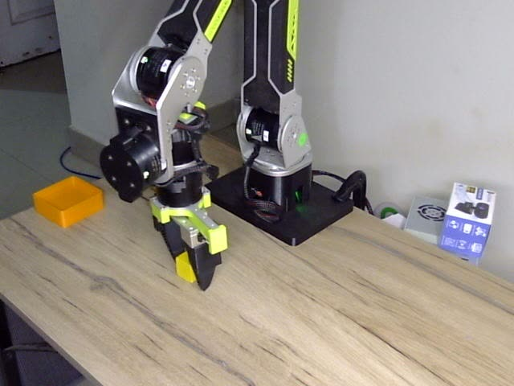
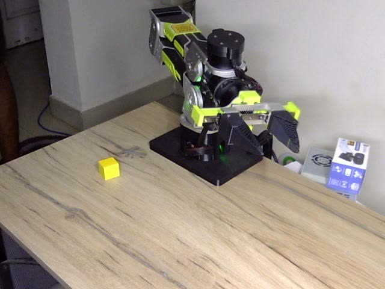
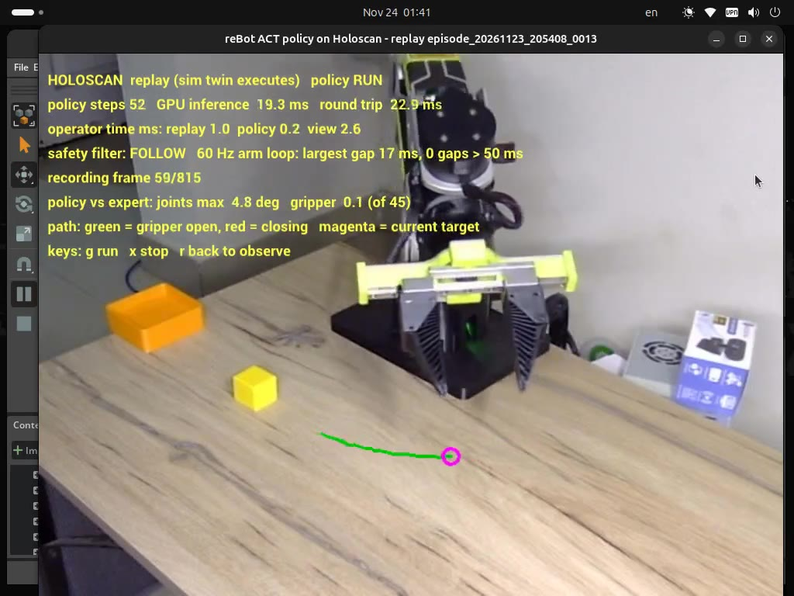
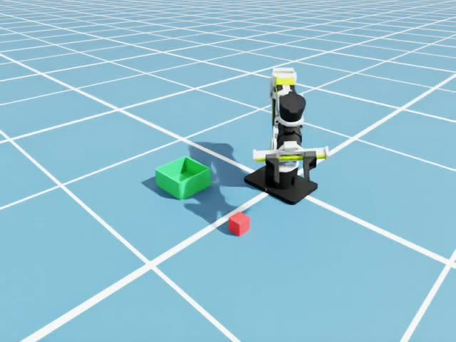
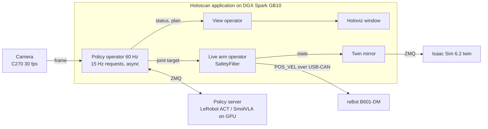

# reBot × NVIDIA Holoscan

A real robot arm, driven by a learned policy through an **NVIDIA Holoscan** pipeline on a **DGX Spark (GB10)**,
with an **Isaac Sim** digital twin, autonomous data collection, and a side-by-side comparison of the same policy
**with and without Holoscan**.



*Left: the Holoscan pipeline. Right: the same policy in a plain Python loop. SmolVLA needs ~0.55 s to compute each
new action chunk; the plain loop waits for it ("loop waited 537 ms") and the arm freezes, while the Holoscan pipeline
keeps the 60 Hz arm loop running (largest gap 17 ms).*

---

## Highlights

- **Seeed reBot B601-DM** (Damiao motors, USB-CAN) controlled from a Holoscan application at 60 Hz
- **Safety layer** between every policy and the motors: speed and acceleration caps, joint limits, table floor,
  torque, temperature, tracking and power-loss checks - any problem means *hold*, never a jump
- **Autonomous data collection**: the arm finds the cube with the camera, picks it and drops it in the box by
  itself - no teleoperation - and records LeRobot episodes
- **Robot-driven camera calibration**: the arm places the cube on a 4 × 3 grid and photographs it
- **ACT** and **SmolVLA** policies trained on the collected data, run live through Holoscan
- **Isaac Sim 6.2 digital twin** that mirrors the real arm, or executes the policy on its own
- Recording tools that film the twin and the policy view **with and without Holoscan**

## Holoscan vs a plain Python loop

Same policy server, same recorded episode, same safety filter, same twin - only the architecture differs.

| | **With Holoscan** | **Plain Python loop** |
|---|---|---|
| Structure | camera, policy, safety + arm and view run as separate operators; inference runs in the background | read camera → wait for the policy → command the arm → draw, one after another |
| **SmolVLA** (≈ 0.55 s per chunk) - largest gap in the 60 Hz arm loop | **18-20 ms**, no gap over 50 ms | **586 ms**, 17 freezes per episode |
| **ACT** (fast, < 90 ms per chunk) - largest gap | **19 ms**, no gap over 50 ms | 83 ms, 10 gaps over 50 ms |
| Accuracy (replay, gripper vs expert) | same | same |

The faster the model, the smaller the difference; for a vision-language-action model like SmolVLA it decides whether
the arm moves smoothly or stops every few seconds.



Full videos: [SmolVLA twin](docs/media/smolvla_twin_holoscan_vs_plain.mp4) ·
[SmolVLA policy view](docs/media/smolvla_overlay_holoscan_vs_plain.mp4) ·
[ACT twin](docs/media/act_twin_holoscan_vs_plain.mp4) ·
[ACT policy view](docs/media/act_overlay_holoscan_vs_plain.mp4)

## The real robot

<p align="center"></p>

| Approach | Grasp | Carry |
|---|---|---|
|  |  |  |

| Camera view (C270, front) | Holoviz window during a run | Isaac Sim twin |
|---|---|---|
|  |  |  |

## Pipeline



The policy runs in its own process (LeRobot environment) and answers over ZMQ; the Holoscan application never
waits for it - the arm keeps receiving targets at 60 Hz while a new chunk is computed.

## What is inside

| Part | File | What it does |
|---|---|---|
| Safety filter | `holoscan_app/safety.py` | speed 15°/s, acceleration limit, joint limits with margins, table floor (refuses only moves that make things worse), torque / temperature / tracking / stale-target / power-loss checks → latched HOLD |
| Live arm | `holoscan_app/real_live.py`, `real_teleop.py` | Damiao motors in POS_VEL, gripper in force-limited position mode with homing on every enable, reconnect after USB loss, safe park |
| Teleop | `run_real_teleop.sh` | leader arm → Holoscan → follower, with the twin mirroring |
| Calibration | `holoscan_app/robot_calibrate.py` | the robot places the cube on a 4 × 3 grid, photographs it, fits the camera-to-table homography |
| Collector | `holoscan_app/collector.py` | perceive (colour + homography) → check → plan → pick & place → verify → record a LeRobot episode |
| Motion planner | `holoscan_app/motion_plan.py` | IK (Pinocchio), top-down approach from 15 cm, straight vertical descents, every sample validated |
| Policy app | `holoscan_app/policy_app.py` | `--replay N` (recorded episode → policy → twin) or `--live` (camera → policy → real arm) |
| Policy server | `holoscan_app/policy_server.py` | loads any LeRobot policy (ACT, SmolVLA, ...), returns the next action and the planned chunk |
| Comparison | `holoscan_app/policy_plain.py`, `record_compare.sh` | the same run as a plain loop; records both and builds the side-by-side videos |

## Results

**Data:** 15 real episodes (12,628 frames, 15 fps), collected autonomously by the scripted collector.

| Policy | Training | Replay accuracy on a recorded episode (gripper vs expert, mean / 90 %) |
|---|---|---|
| ACT (chunk 50) | 25k steps, batch 8, GB10, ~1.2 h | 1.3 cm / 2.3 cm |
| SmolVLA (fine-tuned from `lerobot/smolvla_base`) | 20k steps, batch 32, RTX PRO 6000, ~1 h | **0.6-0.7 cm / 1.1-1.4 cm** |

On the real arm, through the Holoscan pipeline, both policies grasped the cube from positions well covered by
the data, and SmolVLA completed the full pick-and-place into the box.

## Quick start

```bash
# install (Holoscan 4.6 + Isaac Sim 6.2 venvs)
./install_holoscan.sh && ./install_isaacsim.sh

# digital twin (with its own camera)
./run_twin_gui.sh --vision

# real arm: read-only check, then teleop with the leader arm
./run_real_mirror.sh
./run_real_teleop.sh

# camera calibration and autonomous data collection
./open_calibrate_terminal.sh            # e, cube into the gripper, g
./open_collector_terminal.sh 10         # e, then g after placing each cube
./convert_real_dataset.sh cube_to_box_scripted

# policy: server (LeRobot env) + Holoscan app
./run_policy_server.sh train/<run>/checkpoints/last/pretrained_model
./open_policy_terminal.sh --replay 13   # twin only
./open_policy_terminal.sh --live --server-timeout-ms 2000   # real arm: e, then g

# Holoscan vs plain-loop videos
./record_compare.sh <name> 13 2000 both
```

Keys in the arm terminals: `e` enable · `g` go · `x` stop · `s` hold · `r` back to the observe pose · `p` park · `q` quit.

## Lessons learned

1. **Let the arm settle before the gripper acts.** The arm trails its own descent by a few millimetres; releasing or
   grasping immediately put every calibration point 3-5 mm off. A 1 s settle + 1° arrival check fixed it.
2. **Approach from high, then go straight down.** Joint-space swings near the table brushed the cube; arriving
   15 cm above it with a 12 cm floor on every swing removed the contact.
3. **Trust the fingertips, not the model.** The real fingertips reached ~1 cm lower than the URDF said; all
   near-table heights were raised by 1 cm.
4. **Calibrate with the robot itself, and do not touch the camera.** A robot-placed grid beats hand-placed points;
   a camera that moves invalidates the map - fix it firmly.
5. **Cables need strain relief.** A power connector pulled tight in the reaching pose cut joints 2-6 three times; the
   safety layer detected it immediately (motor reports *disabled*), but the arm still sagged onto its stops.
6. **Thermals are part of the design.** The GB10 shut itself off after long training at 95-97 °C. A thermal guard
   that pauses training (freezing only the main process - freezing data-loader workers crashes PyTorch) keeps long
   runs safe; heavy training moved to a workstation GPU.
7. **Data diversity matters more than training steps.** 15 demonstrations from clustered cube positions give a precise
   policy *near those positions*; spread the cube over the whole workspace when collecting.
8. **Make inference asynchronous.** A blocking policy call stalls everything downstream - exactly what the comparison
   videos show, and what the Holoscan design avoids.

## Hardware and software

- Seeed **reBot B601-DM** arm (7 Damiao motors) + leader arm, Logitech **C270** camera
- **NVIDIA DGX Spark (GB10)** for Holoscan, the twin and inference; RTX PRO 6000 for SmolVLA training
- **NVIDIA Holoscan SDK 4.6**, **Isaac Sim 6.2**, **LeRobot 0.6.2** (Seeed fork), PyTorch 2.11, Pinocchio, OpenCV, ZMQ

## Acknowledgements

NVIDIA Holoscan and Isaac Sim · Hugging Face LeRobot, ACT and SmolVLA · Seeed Studio reBot.
